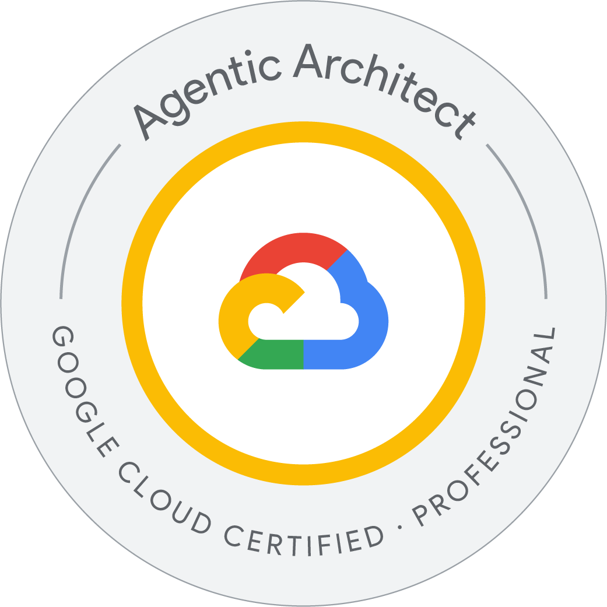
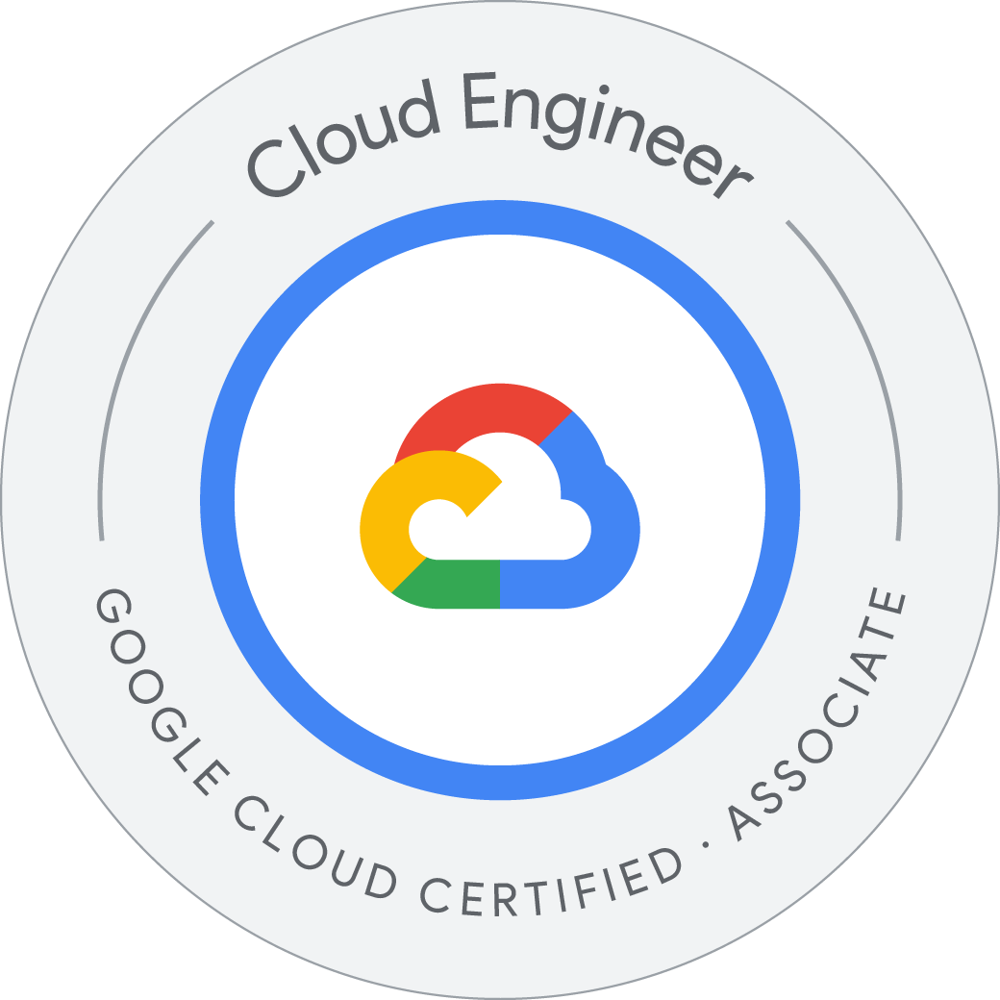

  <h1>Himanshu Singh</h1>
  
<strong>Senior Software Engineer — Agentic AI Architectures & Multi-Tenant Cloud Platforms</strong>

  
Berlin, Germany · B.Tech, IIT Guwahati · <a href="https://www.linkedin.com/in/himanshu-s">LinkedIn</a> · <a href="https://www.credly.com/users/himanshu2408/">Verified Credentials (Credly)</a> · <a href="mailto:singhhimanshu2408@gmail.com">singhhimanshu2408@gmail.com</a>

---

### Engineering Profile

Senior Software Engineer with **9 years of production experience** designing and operating cloud-native, multi-tenant distributed systems on **Google Cloud Platform (GCP)** and architecting production-grade **AI agent systems** (**Google ADK 2.x**, **Model Context Protocol (MCP)**, deterministic pre-flight guardrails, and automated CI/CD evaluation gates).

- **Enterprise Platform Architecture (dunnhumby, 2020–Present):** Lead technical discovery, system architecture, and end-to-end delivery for **DH Sphere**, a multi-tenant retail media platform across in-store digital signage, point-of-sale, and offsite advertising integrations (**Google Ad Manager**, **Meta Marketing API**, and third-party signage CMS providers). Build and evaluate internal agentic workflows on Google Cloud (ADK 2.x, Python, MCP servers, automated evaluation pipelines) and serve on the production on-call rotation.
- **Enterprise Client Delivery (Nagarro, 2017–2020):** Promoted from Trainee to Senior Engineer; architected a global enterprise workflow platform and led the **2-week on-site production launch in Hong Kong**, owning stakeholder discovery, user onboarding, knowledge transfer, and live cutover support.

---

### Featured System Architecture: [Enterprise Context Scout](https://github.com/himanshu2408/enterprise-context-scout)

An enterprise multi-domain context discovery, verification, and implementation platform built on the **Google AI & Open-Weights Stack** (`Gemma 4 26B-A4B-it` MoE, `Gemma 4 E4B-it`, `EmbeddingGemma 2`, `ShieldGemma 2`, `Google ADK 2.12`, `MCP 2.3`, `PostgreSQL 17` with `pgvector`, `pg_trgm`, and `FORCE ROW LEVEL SECURITY`, FastAPI SSE, and strict TypeScript/React).

| Architectural Pillar | Production Implementation | Measured Engineering Metric |
| :--- | :--- | :--- |
| **Tiered Token Economics** | Decouples **$0 local multi-turn discovery** (`Gemma 4 26B-A4B-it` MoE, 3.8B active params + hot-swapped rank-16 QLoRA adapters in `0.018 ms`) from **1-shot frontier execution** (`gemini-3.8-flash` / `gemini-4-argon`) | **97.65% paid frontier token savings** (`2k–4k` verified ContextPack vs. `45k+` raw repo tokens) |
| **Code Intelligence Engine** | Git Blob-SHA Merkle incremental indexing + `tree-sitter` Python/TypeScript AST graph + bounded 1-hop dependency closure ($\le 3$ callers, $\le 1,500$ tokens) + byte-exact `DeterministicSlicer` | **`< 40 ms` incremental Merkle sync** · **100.0% File & Symbol Recall@5** |
| **Research Retrieval Engine** | Multi-market arXiv LaTeX/PDF & OpenAlex harvester (`IN_NSE`, `DE_XETRA`, `US_EQUITY` — 300 full-text papers, 14,331 chunks) + Anthropic Contextual Retrieval + 3-way Normalized RRF (`BM25` + `pgvector` 768-d + `pg_trgm`) + Market Friction Scepticism Gate | **100.0% Zero-Touch Sufficiency** · **100.0% NFKC Verbatim Citation Faithfulness** ($\ge 0.98$ overlap) |
| **Kernel-Level Multi-Tenant Security** | Out-of-band `PrincipalContext` binding via `contextvars` in MCP 2.3 servers (zero identity parameters exposed to LLM prompts) + PostgreSQL 17 `FORCE ROW LEVEL SECURITY` (`SET LOCAL app.principal_scopes`) + `ShieldGemma 2` guardrails | **100.0% RBAC Zero-Leakage** (22 red-team cross-tenant probes) · **95.45% Prompt-Injection Block Rate** |
| **Verification & CI/CD Gates** | 6-gate automated evaluation harness, OpenTelemetry GenAI semantic conventions, isolated `GitWorktreeSandbox` with `require_confirmation=True` human-in-the-loop write approval | **537/537 Python tests + 43/43 strict-TS Vitest tests passing** (`0` `mypy --strict` / `ruff` / `eslint` errors) |

- **Companion Empirical Study — [NIFTY 50 EOD Walk-Forward & Challenger Evaluation (`nifty-eod-dashboard`)](https://github.com/himanshu2408/nifty-eod-dashboard):** Live post-mortem and challenger evaluation dashboard analyzing how baseline technical/momentum signals degrade under real `IN_NSE` delivery friction ($\ge 15\text{ bps}$ STT/exchange costs) and volatility regime shifts—directly motivating the deterministic **Market-Regime Quant Scepticism Gate** in `enterprise-context-scout`.

---

### Google Cloud Certifications

  
  &nbsp;&nbsp;&nbsp;&nbsp;&nbsp;&nbsp;
  
  

    <a href="https://www.credly.com/badges/5b825ca6-927b-4c08-8c9d-77945be6600c/public_url"><strong>Google Cloud Certified — Professional Agentic Architect</strong></a> <em>(Proctored Exam + Hands-On Performance Labs, Nov 2026)</em> 
    <a href="https://www.credly.com/badges/6e869054-b3cf-4f6a-9fef-46c2806263b3/public_url"><strong>Google Cloud Certified — Associate Cloud Engineer</strong></a> <em>(May 2026)</em>
  

---

### Core Technical Stack

- **Agentic AI & Retrieval:** Google ADK 2.x (`Workflow` DAGs), Model Context Protocol (`MCP` 2.3 `stdio` & Streamable HTTP), Hybrid RAG (Anthropic Contextual Retrieval, BM25 + `pgvector` HNSW Reciprocal Rank Fusion), `tree-sitter` AST Code Graphs, QLoRA Fine-Tuning (`MLX` / Vertex AI PEFT), OpenTelemetry GenAI Tracing, Automated LLM Evaluation Harnesses.
- **Languages & Backend:** Python 3.11+ (`FastAPI`, `Pydantic v2`, `psycopg 3`, `pytest`, `mypy --strict`, `ruff`, `uv`), TypeScript (`strict` mode), C# / ASP.NET Core Web API, PostgreSQL 17 (`pgvector`, `pg_trgm`, `FORCE ROW LEVEL SECURITY`), GraphQL.
- **Cloud, Security & Frontend:** Google Cloud Platform (Cloud Run, Vertex AI / Gemini Enterprise Agent Platform, GKE, BigQuery, Workload Identity Federation, Model Armor), Docker, Kubernetes, Terraform, GitLab CI/CD, GitHub Actions, React 18, Angular (Module Federation).
